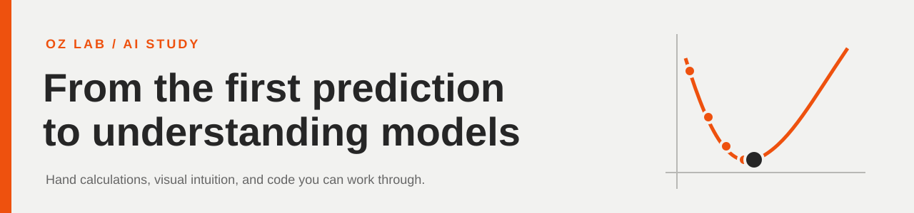

# OZ AI Study Material

[English](README.md) · [한국어](README.ko.md)

머신러닝을 처음 배우는 학생이 Transformer를 직접 구현하기까지 사용할 수업 자료입니다
손으로 예측값과 비용을 계산하고, 그래프에 점을 찍은 뒤, 같은 계산을 코드로 구현합니다

**[주차별 자료](weekly/README.md)** · **[공통 자료](common/README.md)** · **[한국어 학생용 Colab](https://colab.research.google.com/github/CarterYoo/OZ-AI-Study-Material/blob/main/common/course-1/notebooks/optional-labs.student.ko.ipynb)** · **[한국어 답안 Colab](https://colab.research.google.com/github/CarterYoo/OZ-AI-Study-Material/blob/main/common/course-1/notebooks/optional-labs.answers.ko.ipynb)**

## 사용 순서

1. 각 주차의 학생용 워크시트에서 값을 계산하고 그래프를 그려보시오
2. 학생용 Colab의 준비 셀 두 개를 실행한 뒤 실습을 순서대로 진행하시오
3. 수학 계산의 핵심 부분을 한 줄씩 채우고, 별도 답지에서 풀이 과정을 확인하시오

학생용 코드의 `TODO(...)`는 빈칸을 채우기 전까지 의도적으로 오류를 발생시킵니다
아직 구현하지 않은 상태에서 모두 실행하면 해당 셀에서 멈춥니다

## 주차별 자료

주차는 달력상의 날짜가 아니라 Machine Learning Specialization Course 1의 W1·W2·W3에 해당합니다
한 주차를 여러 번의 모임으로 나누어 사용할 수 있습니다

| 주차 | 내용 | 자료 |
| :--- | :--- | :--- |
| W1 | Linear Regression, Cost Function, Gradient Descent | [워크시트·답지·Colab](weekly/week-01/README.md) |
| W2 | 여러 Feature, Vectorization, Feature Scaling | [워크시트·답지·Colab](weekly/week-02/README.md) |
| W3 | Sigmoid, Decision Boundary, MSE와 Logistic Loss 비교 | [워크시트·답지·Colab](weekly/week-03/README.md) |

각 주차에는 개념 확인 문제와 발표자 노트도 들어 있습니다
영어판과 한국어판은 같은 데이터·수식·예제·풀이 단계를 사용합니다

## 공통 자료

| 자료 | 내용 |
| :--- | :--- |
| [AI Safety](common/ai-safety/README.md) | AI 안전 입문과 기술적 접근 슬라이드, 자세한 발표자 노트 |
| [선형대수](common/linear-algebra/README.md) | 3Blue1Brown 과제와 연결되는 시각적 퀴즈와 풀이 |
| [Course 1](common/course-1/README.md) | 통합 슬라이드, 상세 강의 스크립트, Optional Lab 19개 |
| [Transformer](common/transformers/README.md) | 입문 슬라이드 24장과 자세한 설명 |

## 언어와 파일

수업 자료 본문과 발표자 노트는 한국어·영어 두 버전을 제공합니다
`.ko`는 한국어판, `.en`은 영어판입니다
언어 표시가 없는 기존 Optional Lab 노트북은 영어판입니다
코드와 원래 코드 주석은 두 언어판에서 같은 영어 코드를 사용합니다

PDF는 인쇄용, `.tex`는 워크시트 편집용, `.pptx`는 슬라이드 편집용입니다
`.pptx`는 Google Slides로 가져와서 사용할 수 있습니다
학생용과 답안용은 별도 파일이며, 워크시트 답지의 풀이와 그래프 표시는 빨간색입니다

자료 출처는 [Sources](docs/sources.md), PDF 수정 방법은 [Build guide](docs/building-pdfs.md)에서 확인할 수 있습니다
원래 수업 자료와 외부 이미지의 권리는 각 제작자에게 있습니다
